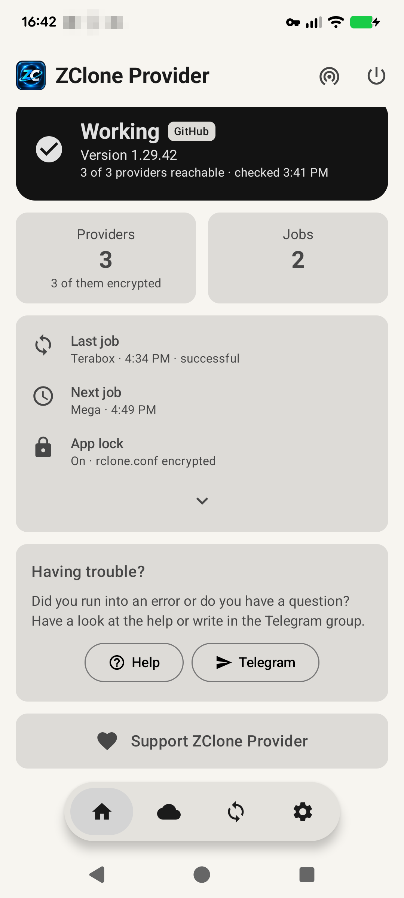
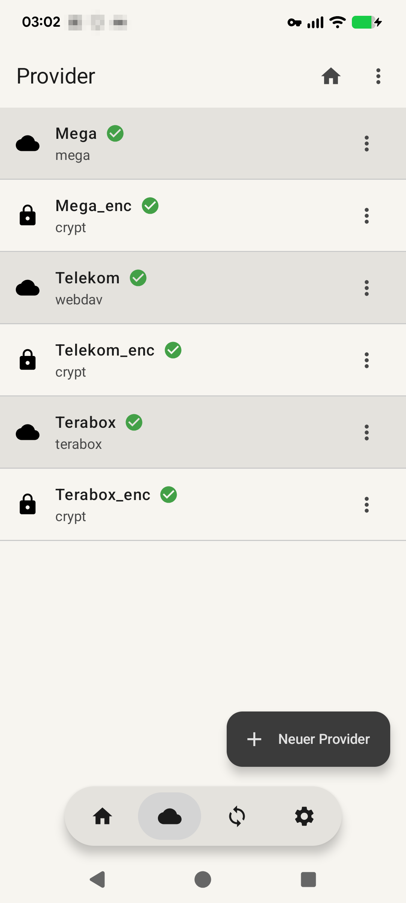
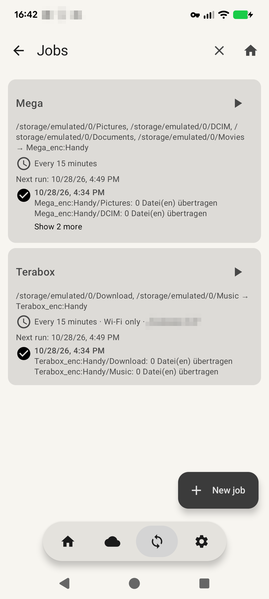
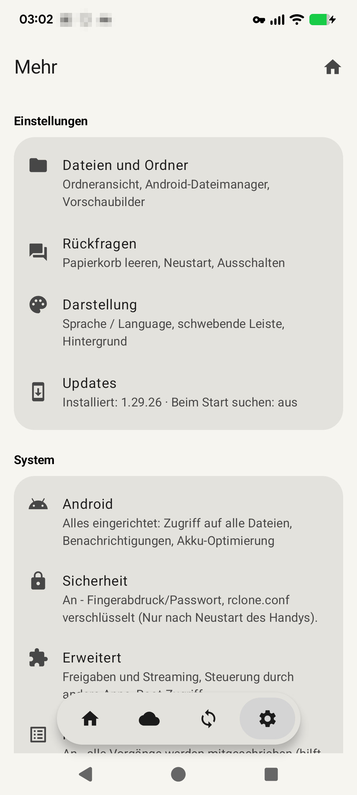
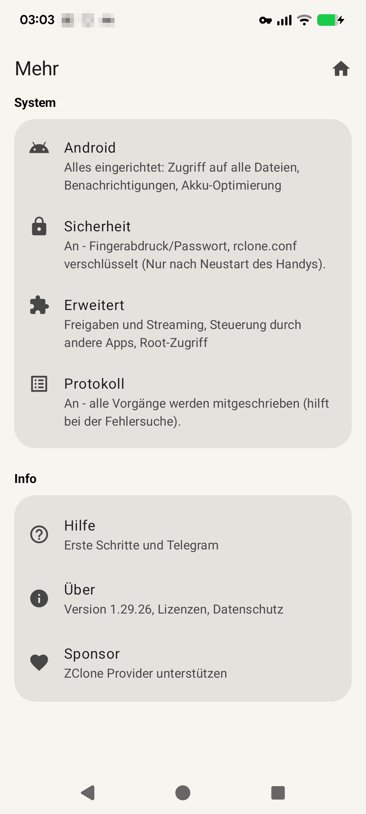

# ZClone Provider (Android)

**ZClone Provider** bringt die Cloud-Speicher („Provider“) aus [ZClone](https://github.com/Temkina/zclone_beta)
aufs Android-Handy, aufs Tablet und aufs Chromebook. Die App kann:

- Dateien durchsuchen, hoch- und herunterladen und verschieben,
- Videos und Musik direkt abspielen,
- Handy-Ordner automatisch sichern oder in beide Richtungen abgleichen,
- Ordner im WLAN freigeben.

Unter der Haube arbeitet dasselbe **rclone-extra** wie bei ZClone am PC. Damit funktionieren alle Provider
aus der PC-Konfiguration auch auf dem Handy, z. B. Google Drive, OneDrive, Dropbox, Mega, Terabox,
WebDAV (Telekom, Nextcloud …) und verschlüsselte crypt-Provider.

| | |
|---|---|
| **Android** | ab Android 12 |
| **Geräte** | Handys und Tablets mit ARM (64 und 32 Bit), Chromebooks und Tablets mit Intel/AMD (64 und 32 Bit) |
| **Sprachen** | Deutsch, Englisch, Französisch, Spanisch, Portugiesisch, Polnisch, Rumänisch, Russisch, Ukrainisch, Chinesisch (vereinfacht), Japanisch, Arabisch. Die App folgt der Handysprache, die Sprache ist aber auch fest einstellbar. |
| **Download** | [Releases auf zclone-provider-beta](https://github.com/Temkina/zclone-provider-beta/releases), Tag `android-<Version>` |
| **Konto** | Ein Konto bei uns ist nicht nötig. |

*English summary at the end of this file.*

## Bildschirmfotos

  
  
  
  
  

Startseite, Provider, Aufträge und *Mehr* (Hintergrund Elfenbein).

---

## Inhalt

- [Bildschirmfotos](#bildschirmfotos)
- [Installation und erste Schritte](#installation-und-erste-schritte)
- [Bedienung](#bedienung)
- [Funktionen](#funktionen)
- [Berechtigungen](#berechtigungen)
- [Datenschutz und Sicherheit](#datenschutz-und-sicherheit)
- [Zusammenspiel mit ZClone am PC](#zusammenspiel-mit-zclone-am-pc)
- [Grenzen](#grenzen)
- [Lizenzen](#lizenzen)
- [English summary](#english-summary)

---

## Installation und erste Schritte

1. **APK laden:** Im neuesten Release mit dem Tag `android-<Version>` die passende Datei wählen:

   | Datei | für |
   |---|---|
   | `ZCloneProvider-<Version>-arm64.apk` | fast alle Handys und Tablets, ARM-Chromebooks – **empfohlen** |
   | `ZCloneProvider-<Version>-x64.apk` | Chromebooks und Tablets mit Intel/AMD |
   | `ZCloneProvider-<Version>-x86.apk` | ältere Intel-Tablets, Android-x86 und Emulatoren (32 Bit) |
   | `ZCloneProvider-<Version>-arm32.apk` | ältere Handys mit 32-Bit-Prozessor |

2. **Installieren:** Die APK auf dem Handy öffnen und die Installation aus dieser Quelle einmalig erlauben.
   Spätere Versionen kommen direkt aus der App (siehe [Updates](#updates)).
3. **Provider einrichten**, entweder
   - eine `rclone.conf` von rclone oder ZClone am PC **importieren** und dabei die gewünschten Provider auswählen, oder
   - einen Provider **neu anlegen** (*Provider → ⋮ → Neu* oder Antippen der Statuskarte auf der Startseite).

   Schritt für Schritt am Beispiel Mega: *Mehr → Hilfe*.
4. Für **Aufträge** (automatische Synchronisation) einmalig *Zugriff auf alle Dateien* erlauben
   (*Mehr → Android*). Für Durchsuchen, Teilen und Streaming ist das nicht nötig.
5. Unter *Mehr → Android* empfiehlt es sich außerdem,
   - die *Benachrichtigungen* zu erlauben (Fortschritt, Ergebnisse, Konflikte, Statussymbol) und
   - die App von der *Akku-Optimierung* auszunehmen (zuverlässige Aufträge im Hintergrund).

   Die Seite zeigt je Punkt einen grünen Haken oder ein rotes Kreuz.
6. Optional: die [App-Sperre](#app-sperre-und-verschlüsselung) einschalten.

---

## Bedienung

Die App hat vier Bereiche: **Startseite**, **Provider**, **Aufträge** und **Mehr**.

### Schwebende Leiste

- Unten liegt eine schwebende Leiste mit den vier Bereichen; *Mehr* ist das Zahnrad.
- Sie erscheint auf allen Seiten, auch auf Unterseiten wie Hilfe, Einstellungen oder Dateien, und markiert den
  Bereich, aus dem die Seite geöffnet wurde.
- Ein Tipp auf einen Bereich öffnet immer dessen erste Seite.
- Sie liegt über dem Inhalt, verschwindet beim Scrollen nach unten und kommt beim Scrollen nach oben und auf jeder
  neuen Seite wieder. Unter dem letzten Eintrag jeder Seite bleibt Platz, damit nichts verdeckt bleibt.
- Abschaltbar unter *Mehr → Darstellung → Schwebende Leiste*. Dann öffnen sich *Provider* und *Aufträge* über
  die Kacheln der Startseite und *Mehr* über das Zahnrad oben auf der Startseite.
- Auf breiten Bildschirmen (Tablets, Chromebooks) liegt die Navigation seitlich, Listen und Details stehen nebeneinander.
- Das **Haus** oben auf den anderen Seiten führt immer zur Startseite.

### Startseite

Die App öffnet immer mit der Startseite.

- **Oben:** links das App-Symbol, rechts die Symbole *Freigaben und Streaming* und *Ausschalten oder Neustart*; bei
  ausgeschalteter Leiste zusätzlich das Zahnrad für *Mehr*. Das Symbol *Ausschalten oder Neustart* öffnet ein Menü:

  | Eintrag | Funktion |
  |---|---|
  | *Ausschalten* | App komplett beenden, mit Rückfrage (abschaltbar unter *Mehr → Rückfragen → Ausschalten*). Freigaben, Streaming und die Sofort-Überwachung enden, ein laufender Auftrag wird abgebrochen und später wiederholt. Geplante Aufträge und die Hintergrundprüfung starten die App zu ihrer Zeit wieder. |
  | *Neustart* | App neu starten (Rückfrage abschaltbar, siehe [Weitere Seiten unter „Mehr“](#weitere-seiten-unter-mehr)) |
  | *Jetzt sperren* | App sofort sperren (nur bei eingeschalteter [App-Sperre](#app-sperre-und-verschlüsselung)) |
- **Statuskarte:**

  | Anzeige | Bedeutung |
  |---|---|
  | **Arbeitet** | Alle Provider waren bei der letzten Prüfung erreichbar, kein Auftrag ist zuletzt gescheitert, und seit dem Start (bzw. dem letzten Ansehen des Protokolls) gab es keinen Programmfehler. |
  | **Eingeschränkt** | Zuerst, wie viele Provider erreichbar sind (z. B. „5 von 6 Providern erreichbar“), darunter der Grund: nicht erreichbare Provider, fehlgeschlagene Aufträge, Programmfehler. |
  | **Nicht geprüft** | Für mindestens einen Provider gibt es noch kein Ergebnis. |
  | **Wird geprüft …** | Die Prüfung läuft. |
  | **Provider werden verbunden** | Die Providerliste wird gerade geladen. |
  | **Keine Provider vorhanden** | Es ist noch kein Provider eingerichtet; die Kachel *Provider* ist dann rot. |

  - Als Programmfehler zählt ein Fehlereintrag mit unerwarteter Ausnahme, nicht eine Fehlermeldung von rclone.
  - Darunter stehen die Version der App, das Abzeichen *GitHub* bzw. *Google Play* und die Uhrzeit der letzten Prüfung.
  - Antippen prüft alle Provider neu; ohne Provider öffnet es *Neuer Provider*.
  - Das Ergebnis bleibt gespeichert, auch über einen Neustart der App. Automatisch geprüft wird beim Start nur, was
    noch kein Ergebnis hat (also einmal nach dem Anlegen eines Providers), nach einem Neustart des Handys alle Provider
    und außerdem still im Hintergrund alle 3 Stunden (siehe [Provider verwalten](#provider-verwalten)).
  - Jeder Wechsel der Statuskarte steht mit Grund im Protokoll.
- **Kacheln** *Provider* und *Aufträge* mit Anzahl; Antippen öffnet den Bereich.
- **Infokarte:** letzter und nächster Auftrag, App-Sperre; aufgeklappt zusätzlich App-Version, rclone-Version und Freigaben.
- **Haben Sie Schwierigkeiten?** mit *Hilfe* und *Telegram*.
- **ZClone Provider unterstützen** (nur in der Version von GitHub): öffnet *Sponsor*.

---

## Funktionen

### Provider übernehmen (Import)

*Provider → ⋮ → rclone.conf → Importieren*

- Liest eine `rclone.conf` von rclone oder von ZClone am PC – das Format ist dasselbe. Bei rclone zeigt
  `rclone config file`, wo sie liegt; bei ZClone liegt sie in `Konfiguration\Rclone`.
- Sie wählen **einzelne Provider** aus, nicht zwingend alle.
- **Abhängigkeiten** kommen automatisch mit. Wer einen crypt-Provider wählt, bekommt den Provider darunter dazu.
- **Mit Passwort verschlüsselte `rclone.conf`** werden unterstützt: Passwort eingeben, „Entschlüsseln“, dann auswählen.
- **Ihre vorhandenen Provider bleiben erhalten:** Der Import ergänzt nur, er ersetzt nicht die ganze `rclone.conf`.
- Gibt es einen Provider schon, wählen Sie **behalten**, **ersetzen** oder **importierte umbenennen**:
  - *behalten:* Ihr Provider bleibt, der aus der Datei wird nicht übernommen.
  - *ersetzen:* Der aus der Datei ersetzt Ihren.
  - *importierte umbenennen:* Der aus der Datei kommt unter neuem Namen dazu (z. B. „Mega 2“), Verweise darauf
    (z. B. von einem verschlüsselten Bereich) werden angepasst, Ihrer bleibt unverändert.
  - Braucht ein Provider der Datei einen gleichnamigen, den Sie schon haben (z. B. `Mega_enc` → `Mega`), ist
    *importierte umbenennen* vorausgewählt. Sonst zeigte `Mega_enc` auf Ihr eigenes Konto oder ersetzte es.
- Fehlerhafte Zeitangaben aus älteren Konfigurationen (Nanosekunden ohne Einheit) werden beim Import korrigiert.
- **QR-Code scannen:** Statt einer Datei liest der Import auch einen QR-Code – eine [Weitergabe](#provider-weitergeben)
  oder eine [WebDAV-Freigabe](#freigaben-im-wlan) vom anderen Handy. Mit der Kamera (die Erlaubnis fragt die App erst
  hier) oder *Aus Bild lesen*, z. B. aus einem zugeschickten Bildschirmfoto.

Tipp: Die `rclone.conf` enthält Zugangsdaten. Die Kopie auf dem Handy nach dem Import wieder löschen.

### Provider verwalten

Die Providerliste ist abwechselnd hinterlegt: der erste, dritte, fünfte … Provider in der Kartenfarbe, die übrigen in
der Hintergrundfarbe.

**⋮ oben auf der Providerliste**, jeweils mit Symbol:

| Eintrag | Funktion |
|---|---|
| *Neu* | neuen Provider anlegen |
| *Neustart* | App neu starten (Rückfrage abschaltbar unter *Mehr → Rückfragen → Neustart*) |
| *Test* | alle Provider prüfen |
| *rclone.conf* | Importieren oder Exportieren |
| *Auswählen*, *Alle auswählen* | mehrere Provider auswählen |

**Neu anlegen:**
- Alle Provider-Typen von rclone-extra stehen zur Wahl, mit Suche (z. B. „Google“, „OneDrive“, „WebDAV“).
- Das Fragezeichen öffnet die rclone-Hilfe zum gewählten Typ.
- Adressen in den Erklärungen unter den Feldern (z. B. bei *client_id* von Google Drive) lassen sich antippen und öffnen
  sich im Browser.
- Ist noch kein Provider eingerichtet, zeigt *Neuer Provider* oben einen Hinweis auf die Hilfe; auch die leere
  Providerliste verweist darauf.
- Beim Typ pCloud steht ein als **Empfehlungslink** gekennzeichneter Hinweis „pCloud-Konto anlegen“ (nur in der
  Version von GitHub). Wer sich darüber anmeldet, unterstützt die Entwicklung (Provision von pCloud); es werden
  keine Daten aus der App übertragen, der Link öffnet nur den Browser.
- Bei Anbietern mit Anmeldung öffnet sich der Browser, danach geht es automatisch weiter.
- Rückfragen von rclone (z. B. welches OneDrive-Laufwerk) stellt die App als Auswahl.

**⋮ am Provider:** Bearbeiten, Neu anmelden (abgelaufene Anmeldung erneuern), Umbenennen, Löschen,
Verbindung testen, Ordneransicht in der App, Ordneransicht beim Teilen, Verschlüsselten Bereich anlegen, Papierkorb leeren.

**Alle Provider prüfen** (*⋮ → Test* oder Statuskarte der Startseite):
- Prüft alle Provider auf einmal, höchstens vier gleichzeitig, je Provider höchstens 60 Sekunden.
- Neben dem Namen erscheint ein **grüner Haken** (erreichbar) bzw. ein **rotes Kreuz** (nicht erreichbar), während
  der Prüfung ein Ladekreis. Das Ergebnis bleibt gespeichert bis zur nächsten Prüfung.
- Provider mit gemeinsamem Zugang (z. B. Mega und Mega_enc) werden nacheinander geprüft, weil Mega bei gleichzeitiger
  Anmeldung eines der beiden ablehnt.
- Automatisch geprüft wird beim Start der App nur, was noch kein Ergebnis hat, und nach einem Neustart des Handys alles.
- **Im Hintergrund alle 3 Stunden** prüft die App alle Provider still, ohne Benachrichtigung, sobald eine
  Internetverbindung besteht; Haken, Kreuze und Statuskarte sind danach aktuell. Läuft gerade ein Auftrag, wird
  ausgelassen, damit sich Prüfung und Auftrag beim selben Anbieter nicht stören. Android hält den Abstand nicht
  sekundengenau ein.
- **Datenverbrauch:** Je Provider wird nur der oberste Ordner aufgelistet (ohne Unterordner und Dateiinhalte). Wie viel
  das war, steht nach jeder Prüfung im Protokoll („Datenverkehr der App währenddessen: … empfangen, … gesendet“).

**Papierkorb leeren** (bzw. bereinigen) – nur bei Anbietern, die es können (`rclone cleanup`), mit Rückfrage
(abschaltbar unter *Mehr → Rückfragen → Papierkorb leeren*):
- *Papierkorb leeren:* Google Drive, Mega, pCloud, Box, Jottacloud, Yandex, Mail.ru, PikPak, Proton Drive, put.io,
  Terabox, Filen, Seafile, Huawei Drive, FileFabric. Google Drive leert im Hintergrund (Minuten bis Tage).
- *Papierkorb leeren bei WebDAV auf Nextcloud*, z. B. Telekom MagentaCLOUD (Adresse mit `/remote.php/`):
  rclone kann das bei WebDAV nicht, deshalb schickt die App über rclone die Nextcloud-Anfrage zum Leeren
  (`DELETE …/remote.php/dav/trashbin/<Benutzer>/trash`) – mit den gespeicherten Zugangsdaten. Als Benutzer gilt
  zuerst der Anmeldename; kennt der Server ihn dort nicht, der Benutzerordner, den er im Papierkorb-Verzeichnis zeigt.
  Jeder Schritt steht im Protokoll.
- *Alte Versionen löschen:* OneDrive (von jeder Datei bleibt nur die aktuelle Version; kann lange dauern), Internet Archive.
- *Alte Versionen und abgebrochene Uploads löschen:* Backblaze B2.
- *Abgebrochene Uploads löschen* (älter als 24 Stunden): S3, QingStor, Oracle Object Storage.
- Bei einem verschlüsselten Bereich (crypt) geschieht es beim Provider darunter; der Papierkorb ist dann der
  ganze Papierkorb dieses Providers.

**Mehrere löschen:** Langes Drücken auf einen Provider (oder *⋮ oben → Auswählen*) startet die Auswahl, wie in der
Dateiliste. Die Rückfrage nennt alle gewählten Provider und die darauf aufbauenden (z. B. crypt), die mit gelöscht
werden.

**Umbenennen und Löschen:**
- Umbenennen zieht Verweise mit, etwa den Basis-Provider eines crypt-Providers und die Aufträge.
- Beim Löschen werden abhängige Provider (crypt) angezeigt und auf Wunsch mit entfernt.
- In Aufträgen fällt nur dieses Ziel weg. Hatte ein Auftrag kein anderes Ziel, wird er entfernt.
- Die Dateien beim Anbieter bleiben immer unberührt.

crypt-Provider sind mit einem **Schloss** gekennzeichnet.

### Verschlüsselter Bereich

*Direkt nach dem Einrichten eines neuen Providers oder über ⋮ am Provider → Verschlüsselten Bereich anlegen*

- Legt zum Provider einen **crypt-Provider** an. Was Sie dorthin hochladen, liegt beim Anbieter verschlüsselt,
  auch die Datei- und Ordnernamen.
- Vorbelegt sind der Name `<Provider>_enc` und ein Ordner beim Provider. Sie wählen das Passwort,
  ein zufälliger Salt wird auf Wunsch dazu erzeugt. Der Ordner wird beim Anbieter angelegt.
- **Wichtig:** Ohne dieses Passwort und ohne die `rclone.conf` lassen sich die Daten nicht mehr entschlüsseln.
  Danach die `rclone.conf` sichern.
- Wählen Sie bei einem Auftrag oder beim Teilen einen unverschlüsselten Provider, zu dem es einen verschlüsselten
  gibt, schlägt die App einmal den verschlüsselten vor. Wer „unverschlüsselt bleiben“ wählt, wird für diesen
  Provider nicht wieder gefragt.
- Die Einstellungen sind normales rclone-Format und funktionieren genauso in ZClone am PC.

### Dateien

*Provider → Provider antippen*

- **Navigation:** Ordner durchsuchen mit Pfadleiste („Brotkrumen“), Aktualisieren, neuer Ordner.
  Ein Provider öffnet sich im obersten Ordner; mit *Mehr → Dateien und Ordner → Ordneransicht in der App* im
  zuletzt in der App geöffneten Ordner (je Provider getrennt, je Provider abweichend einstellbar unter
  *Providerliste → ⋮ am Provider → Ordneransicht in der App*). Unabhängig von der Ordneransicht beim Teilen.
  Gibt es den gemerkten Ordner nicht mehr, beginnt die Ansicht im obersten Ordner.
  Liegt ein verschlüsselter Bereich (oder eine andere Hülle) in einem Ordner, steht dieser neben dem Provider,
  z. B. „Telekom_enc: in Telekom:Verschlüsselt“; nutzt er den ganzen Speicher („Telekom:“), steht dort nichts.
- **Vorschaubilder** für Bilder und Videos, einstellbar unter *Mehr → Dateien und Ordner → Vorschaubilder*: aus, nur im WLAN oder immer.
- **Hochladen** (eine oder mehrere Dateien), **Herunterladen** von Dateien oder ganzen Ordnern.
  Vor dem Herunterladen zeigt ein Dialog das Ziel: Standard ist `Download/ZClone`, *Ordner ändern* wählt über die
  Android-Ordnerauswahl einen anderen (auch SD-Karte oder USB-Stick). Der gewählte Ordner wird beim nächsten Mal
  vorgeschlagen; *Standard* stellt `Download/ZClone` wieder her.
- **Öffnen** und **Teilen** mit anderen Apps. Die Datei wird dafür kurz in den privaten Speicher der App geladen.
- **Umbenennen** und **Löschen**, beim Löschen mit Rückfrage.
- **Mehrere auswählen:** Langes Drücken auf eine Datei oder einen Ordner oder *⋮ neben dem Haus → Auswählen*
  startet die Auswahl. Danach wählt Tippen weitere aus oder ab. Das *⋮* neben dem Haus bietet dann für alle
  ausgewählten Einträge **Herunterladen, Teilen, Verschieben, Kopieren, Löschen** und *Alle auswählen*
  (das *⋮* an einer Zeile bleibt für den einzelnen Eintrag).
  - Verarbeitet wird nacheinander („2 von 5“). Klappt ein Eintrag nicht, geht es mit den übrigen weiter,
    und die Meldung nennt, was übrig blieb.
  - Löschen fragt nach und warnt, wenn Ordner samt Inhalt dabei sind.
  - Teilen gibt nur Dateien weiter; Ordner lassen sich nicht teilen (mit Hinweis).
  - Verschieben/Kopieren merkt die Auswahl vor; im Zielordner *Hier einfügen* tippen.
  - *Zurück* oder *✕* beendet die Auswahl.
- Bei crypt-Providern sieht und bearbeitet man die entschlüsselten Namen und Inhalte.
- **Ordner beim Anbieter gelöscht** (z. B. der Ordner hinter einem verschlüsselten Bereich): Statt eines
  rclone-Fehlers zeigt die App einen Hinweis mit dem Knopf *Ordner neu anlegen*; Hochladen legt ihn ebenfalls
  wieder an. Fehlt ein Unterordner, erscheint „Dieser Ordner existiert nicht mehr.“

### Verschieben und Kopieren

*⋮ an einer Datei oder einem Ordner → Verschieben / Kopieren → zum Zielordner wechseln → „Hier einfügen“*

- Funktioniert für **Dateien und ganze Ordner**, auch **zwischen verschiedenen Providern**, z. B. „von Google Drive
  in den verschlüsselten Telekom-Ordner“.
- Innerhalb eines Providers verschiebt rclone möglichst direkt beim Anbieter, ohne die Daten neu zu übertragen.
- **Nie überschreiben:** Liegt im Ziel schon etwas mit demselben Namen, bricht die App ab.
- Ein Ordner kann nicht in sich selbst verschoben werden.

### Im Android-Dateimanager

*Mehr → Dateien und Ordner → Im Android-Dateimanager anzeigen*

- Die Provider erscheinen in der App „Dateien“ und in der Dateiauswahl anderer Apps.
- So lassen sich Dateien direkt aus anderen Apps öffnen, speichern und hochladen.
- Ist die App-Sperre an, sind die Provider dort nur sichtbar, solange die App entsperrt ist.

### Streaming

*Video- oder Musikdatei antippen*

- Spielt direkt vom Provider ab, in einem Player Ihrer Wahl (z. B. VLC), **ohne vorher die ganze Datei zu laden**.
  Vorspulen funktioniert. Auch verschlüsselte Dateien von crypt-Providern lassen sich streamen.
- Technik: ein kleiner rclone-HTTP-Server, **nur auf diesem Handy erreichbar**, schreibgeschützt und mit
  einem zufälligen, geheimen Pfad.
- Im Menü bleibt *Laden und öffnen* für den klassischen Weg.

### Freigaben im WLAN

*Startseite → Symbol „Freigaben und Streaming“*, *Mehr → Erweitert → Freigaben und Streaming* oder das
Freigabe-Symbol in der Dateiliste (gibt den angezeigten Ordner frei)

Stellt einen Provider-Ordner für andere Geräte im selben WLAN bereit:

| Art | wofür | Anmeldung | Schreiben |
|---|---|---|---|
| **WebDAV** | Netzlaufwerk im Windows-Explorer, iPad-Dateien-App … | Benutzer + Passwort | wählbar |
| **HTTP** | im Browser ansehen und herunterladen | Benutzer + Passwort | wählbar |
| **FTP** | FileZilla, Total Commander … | Benutzer + Passwort | wählbar |
| **DLNA** | Medienserver für Fernseher, Receiver, Konsolen | keine | nur lesen |

- Die App zeigt die Adresse(n) an (z. B. `http://192.168.1.20:8081/`) samt Zugangsdaten, mit Taste zum Kopieren.
- Das Passwort wird zufällig erzeugt und lässt sich ändern.
- Freigaben laufen weiter, bis Sie sie beenden, auch bei gesperrter App und ausgeschaltetem Bildschirm.
  Eine Benachrichtigung zeigt sie an und hat die Taste *Alle beenden*. Das kostet Akku.
- DLNA hat keine Anmeldung: Jedes Gerät im WLAN sieht die Dateien. Nur in vertrauenswürdigen Netzen verwenden.
- Lädt jemand per WebDAV oder FTP etwas hoch, landet es sofort beim Provider. Beim Beenden der Freigabe geht so nichts verloren.
- **Als Provider auf anderem Handy:** Bei einer laufenden WebDAV-Freigabe zeigt das QR-Symbol einen QR-Code. Scannt
  ein anderes Handy mit ZClone Provider ihn im selben WLAN (*Provider → ⋮ → rclone.conf → Importieren → QR-Code scannen*),
  kommt dort ein WebDAV-Provider „<Provider> WLAN“ mit Adresse und Anmeldung dazu. Er funktioniert nur, solange die
  Freigabe läuft; bei *nur lesen* lässt sich darüber auch nur lesen.

### iPhone und iPad

*Freigaben und Streaming → iPhone und iPad* (Anleitung in der App)

Die Freigaben funktionieren auch vom iPhone oder iPad aus. Beide Geräte müssen im selben WLAN sein.

| Weg | was geht | was man braucht |
|---|---|---|
| **HTTP** | durchsuchen, herunterladen, Videos und Musik abspielen | nur Safari |
| **WebDAV** | durchsuchen, hoch- und herunterladen, umbenennen, verschieben, löschen, in der App „Dateien“ | eine WebDAV-App, die sich in „Dateien“ einbindet (z. B. Owlfiles) |
| **DLNA** | Videos und Musik streamen | VLC (unter „Netzwerk“) |

„Mit Server verbinden“ in der App „Dateien“ kann nur SMB, und SMB bietet rclone nicht an. Deshalb geht WebDAV
über eine zusätzliche App. Geprüft sind die WebDAV-Funktionen mit rclone-extra: Auflisten, Hoch- und Herunterladen,
Teilabruf (Vorspulen), Umbenennen, Verschieben, Kopieren, Löschen und Sperren, auch bei Namen mit Umlauten.

### Teilen aus anderen Apps

*In Galerie, Dateien-App usw.: Teilen → ZClone Provider*

- Provider und Ordner wählen, hochladen. Bei crypt-Providern wird **verschlüsselt** gespeichert.
- Nach dem Antippen eines Providers beginnt die Ordnerauswahl im obersten Ordner.
  Mit *Mehr → Dateien und Ordner → Ordneransicht beim Teilen* beginnt sie stattdessen in dem Ordner,
  in den zuletzt zu diesem Provider hochgeladen wurde (je Provider getrennt, unabhängig von der Ordneransicht in der App).
- Je Provider lässt sich das abweichend festlegen: *Providerliste → ⋮ am Provider → Ordneransicht beim Teilen* –
  wie in den Einstellungen, immer merken oder immer im obersten Ordner beginnen.
- Neue Ordner lassen sich direkt beim Hochladen anlegen.
- Teilen Sie eine **rclone.conf** (z. B. eine Weitergabe, die per Quick Share oder Bluetooth ankam), erkennt die App
  sie und bietet **Provider importieren** an: Das öffnet gleich den Import, ohne die Datei hochzuladen.
  **Speichern** legt sie stattdessen unverändert an einem Ort Ihrer Wahl ab.

### Aufträge (automatische Synchronisation)

*Aufträge → Neuer Auftrag*

Ein Auftrag verbindet einen oder mehrere **Handy-Ordner** (z. B. `DCIM`, `Pictures`, `Download`) mit einem
oder mehreren **Zielen** (Provider + Ordner). Bei mehreren Ordnern landet jeder beim Ziel in einem eigenen
Unterordner mit seinem Namen.

**Richtung**

| Richtung | was passiert |
|---|---|
| **Hochladen** | Handy → Provider, es wird nichts gelöscht |
| **Spiegeln** | Provider = Handy; **löscht beim Provider**, was es auf dem Handy nicht (mehr) gibt |
| **Herunterladen** | Provider → Handy, es wird nichts gelöscht (nutzt nur den ersten Ordner und das erste Ziel) |
| **Zwei-Wege-Abgleich** | Änderungen und Löschungen auf beiden Seiten werden übernommen (rclone bisync) |

**Wann der Auftrag läuft**

- **Von Hand** mit ▶ (*Jetzt ausführen*). Ein laufender Auftrag lässt sich mit ■ oder in der Benachrichtigung abbrechen.
- **In einem Intervall:** alle 1, 2, 5, 10, 15 oder 30 Minuten, stündlich, alle 6 oder 12 Stunden oder täglich.
- **Zu einer festen Uhrzeit**, täglich oder an gewählten Wochentagen. Exakt geht das nur, wenn Android
  „Wecker und Erinnerungen“ für die App erlaubt. Die App weist darauf hin.
- **Sofort bei Änderungen:**
  - Die Handy-Ordner werden überwacht. Etwa 15 Sekunden nach der letzten Änderung startet der Auftrag.
  - Ausgeschlossene Dateien (z. B. Zwischendateien) lösen keinen Lauf aus.
  - Während der Überwachung steht eine unauffällige Benachrichtigung in der Leiste.
- **Auslöser:**
  - Ein Auftrag kann starten, wenn das Handy lädt und/oder ein WLAN verbunden ist.
  - Danach startet er frühestens nach einem wählbaren Abstand wieder (30 Minuten bis 1 Tag).
- **Änderungen gelten sofort:** Nach dem Speichern ersetzt die App die Planung. Bei Intervall-Aufträgen und
  „Sofort bei Änderungen“ startet gleich ein Lauf. Er hält alle Bedingungen ein.
- **Nächster Lauf:** Die Auftragskarte zeigt, wann Android den Auftrag als Nächstes startet.

**Bedingungen**

Die Bedingungen gelten für automatische Läufe und Auslöser, nicht für *Jetzt ausführen*:

- **Nur im WLAN**, wahlweise **nur in einem bestimmten WLAN** (Name), und/oder **nur beim Laden**.
- **Zeitfenster** (z. B. 22:00–06:00) und **Mindest-Akkustand** (20 bis 80 %). Beim Laden gilt der Akkustand
  immer als erfüllt.
- **Ausgelassene Läufe werden nachgeholt:** Passt eine Bedingung nicht, versucht die App es alle 15 Minuten erneut.
- **Nicht zu oft abgleichen:** In der Auswahl *Automatisch ausführen* steht hinter *Sofort bei Änderungen* bis
  *Alle 10 Minuten* „(temporäre Sperre möglich)“. Ist eine davon gewählt, weist die App außerdem darauf
  hin, dass Anbieter häufige Abgleiche als zu viele Anfragen werten und den Zugang eine Zeit lang bremsen oder sperren
  können. Meldet ein Anbieter das während eines Laufs, steht vor der Fehlermeldung eine verständliche Erklärung, und das
  Protokoll vermerkt es. Erkannt werden die Texte, die rclone dafür ausgibt: HTTP 429 „Too Many Requests“ (z. B. OneDrive,
  pCloud, Terabox), bei Google Drive „rateLimitExceeded“, bei Mega „Rate limit reached“, „Request over quota“,
  „Resource temporarily not available“ und „Too many connections“.

**Weitere Einstellungen**

- **Ausschlüsse** pro Auftrag, ein Muster pro Zeile. Vorbelegt sind temporäre Dateien, Vorschaubilder sowie
  Papierkorb- und Zwischendateien von Android (`*.tmp`, `.thumbnails/**`, `.trashed-*`, `.pending-*` …).
- Übertragen werden **nur neue und geänderte Dateien**.
- **Löschsperre** (Zwei-Wege-Abgleich, je Auftrag 50/75/90 % oder aus):
  - Der Abgleich bricht ab, wenn mehr als dieser Anteil gelöscht würde oder sich alle Dateien einer Seite geändert haben.
  - Nach einem Abbruch lässt er sich gezielt **einmal ohne Sperre** ausführen.

**Ordner**

- Interner Speicher und SD-Karte werden direkt synchronisiert.
- Ordner, die Android nur über die Ordnerauswahl freigibt (z. B. USB-Sticks), laufen über eine Zwischenkopie
  im App-Speicher.
- Mit **Root** lassen sich auch Ordner nutzen, die Android Apps sonst verwehrt (z. B. unter `/data`).
  Dafür *Mehr → Erweitert → Root-Zugriff* einschalten und den Ordner im Auftrag über *Ordner durchsuchen (Root)* wählen.

**Ergebnis**

- Fortschritt und Ergebnis erscheinen in der Benachrichtigung.
- Das letzte Ergebnis steht an der Auftragskarte, je Ziel eine Zeile.
- Aufträge laufen im Hintergrund, auch bei gesperrter App. Nach einem Neustart des Handys und nach einer
  Änderung der Uhrzeit plant die App sie neu.

### Konflikte beim Zwei-Wege-Abgleich

Wurde eine Datei auf beiden Seiten geändert, entscheidet eine **Regel je Auftrag**:

- **neuere Version gewinnt** (Standard),
- **Handy-Version gewinnt**,
- **Provider-Version gewinnt** oder
- **beide behalten**, um später selbst zu entscheiden.

Die andere Version bleibt dabei erhalten: Sie liegt auf beiden Seiten unter einem Namen mit `.handy` bzw.
`.provider` (z. B. `Foto.handy1.jpg`).

Gefundene Konflikte meldet die App per Benachrichtigung und an der Auftragskarte. Auf der **Konfliktseite**
sehen Sie beide Versionen mit Vorschau, Größe und Datum. Dort behalten Sie eine davon (die andere wird auf beiden
Seiten gelöscht) oder übernimmst alle automatischen Entscheidungen auf einmal.

### Steuerung durch andere Apps (Tasker)

*Mehr → Erweitert → Steuerung durch andere Apps*

Ist das eingeschaltet, können andere Apps (z. B. Tasker) Aufträge starten und abbrechen, per Broadcast-Intent:

| | |
|---|---|
| Paket | `de.zclone.provider` |
| Aktion | `de.zclone.provider.AUFTRAG_STARTEN` bzw. `de.zclone.provider.AUFTRAG_ABBRECHEN` |
| Extra | `auftrag` = Name des Auftrags |

Die Funktion ist standardmäßig aus.

### Statussymbol

Ein dauerhaftes ZClone-Symbol in der Statusleiste, wie das Tray-Symbol am PC. Es zeigt, wie viele Aufträge
geplant sind und wie der letzte Lauf ausging. Es erscheint nach einem Neustart des Handys von selbst wieder.
Ausblenden lässt es sich über die Benachrichtigungseinstellungen der App (Kanal „Statussymbol“).

### App-Sperre und Verschlüsselung

*Mehr → Sicherheit* – eine Seite mit den Abschnitten **App-Sperre**, **Bestätigung** und **Weitergeben und Sichern**.
Sperren geht auch über *Startseite → Ausschalten oder Neustart → Jetzt sperren*. Dann erscheint gleich der
Sperrbildschirm; nach dem Fingerabdruck fragt er erst, wenn Sie *Mit Fingerabdruck* antippen.

- Beim Öffnen der App, auch beim Teilen, entsperren Sie mit **Fingerabdruck** oder **App-Passwort**.
- **Sperrzeit wählbar:** sofort, nach 30 Sekunden, nach 1, 5 oder 15 Minuten, nach 1 Stunde oder
  nur nach einem Neustart des Handys.
- Mit dem Einschalten wird die **`rclone.conf` mit dem App-Passwort verschlüsselt**. Das geschieht im
  rclone-eigenen Format, also auch mit rclone am PC lesbar.
- *Passwort ändern* verschlüsselt neu, *Ausschalten* entschlüsselt wieder.
- **Schutz gegen Durchprobieren:** Ab dem 5. falschen Passwort wird die Wartezeit immer länger.
- Aufträge und Freigaben laufen bei gesperrter App weiter.
- **Passwort vergessen?** Auf dem Sperrbildschirm oder unter *Mehr → Sicherheit*:
  - Mit **Fingerabdruck oder der Displaysperre des Handys** (PIN, Muster, Passwort) bestätigen, dann ein
    neues App-Passwort wählen.
  - Die `rclone.conf` wird damit neu verschlüsselt, Provider und Aufträge bleiben erhalten.
  - Das geht, weil die App das Passwort für Aufträge im Hintergrund ohnehin geschützt im Android-Keystore
    bereithält.
- **Wenn der Android-Keystore das Passwort nicht liefert** (z. B. kurz nach einem Neustart):
  - Die App sperrt sich und verlangt das **App-Passwort**; der Fingerabdruck reicht dann nicht.
    Danach geht es mit dem eingegebenen Passwort weiter (nur im Arbeitsspeicher).
  - Es wird dabei nie ein neuer Schlüssel erzeugt und die `rclone.conf` wird nie unverschlüsselt geschrieben.
  - Bis dahin startet rclone nicht und meldet verständlich, warum. Das Protokoll hält den Zustand des
    Keystores fest (Schlüssel vorhanden, Erzeugungsdatum, Sicherheitsstufe).

**Bestätigung vor sensiblen Aktionen** (Abschnitt *Bestätigung*):

- **Vor dem Weitergeben** von Providern (Standard an, abschaltbar).
- **Vor dem unverschlüsselten Export** (immer, nur mit App-Sperre wählbar).
- Mit App-Sperre bestätigen Sie mit **Fingerabdruck oder App-Passwort** (*Passwort verwenden*), ohne App-Sperre mit
  der **Displaysperre des Handys** (PIN, Muster, Passwort oder Fingerabdruck). Ist keins von beidem eingerichtet,
  weist die App darauf hin und gibt nichts weiter. Fehlversuche zählen wie beim Entsperren.

### rclone.conf exportieren

*Mehr → Sicherheit → rclone.conf exportieren* oder *Provider → ⋮ → rclone.conf → Exportieren*

- **Ohne App-Sperre:** speichert die Konfiguration unverschlüsselt an einem Ort Ihrer Wahl.
- **Mit App-Sperre** wählen Sie:
  - **Verschlüsselt:** wie in der App gespeichert, lesbar nur mit dem App-Passwort.
  - **Unverschlüsselt:** erst nach Bestätigung mit Fingerabdruck oder App-Passwort. Entschlüsselt wird nur im Arbeitsspeicher,
    die `rclone.conf` in der App bleibt verschlüsselt.
- Danach wählen Sie **Speichern** (Ort Ihrer Wahl) oder **Senden** (Teilen-Menü von Android, z. B. Quick Share,
  Bluetooth, Messenger). Unverschlüsselt enthält sie alle Zugangsdaten lesbar – nur an sich selbst oder Vertraute
  senden. Die Kopie für das Senden liegt im privaten Speicher der App und wird beim nächsten Start gelöscht.

Eine verschlüsselte `rclone.conf` lässt sich so lesen:
- **rclone** am PC: `"C:\ZClone\Programme\Rclone\rclone.exe" config show --config "D:\rclone.conf"`.
  rclone fragt nach dem Passwort.
- **ZClone am PC** fragt beim Start nach dem Passwort („Konfiguration entsperren“), wenn die Datei als
  `Konfiguration\Rclone\rclone.conf` abgelegt ist. Achtung: Das ersetzt die PC-Konfiguration.
- **Import dieser App** auf einem anderen Handy.

### Provider weitergeben

*Provider → lange auf einen Provider drücken (oder ⋮ → Auswählen) → ⋮ → Weitergeben*, oder
*Mehr → Sicherheit → Provider weitergeben* (öffnet die Providerliste gleich im Auswahlmodus)

Damit zwei Personen über denselben Provider verschlüsselte Daten austauschen, geben Sie einzelne Provider als eigene
`rclone.conf` weiter:

- **Auswahl samt Abhängigkeiten:** Was ein gewählter Provider braucht, kommt automatisch mit und wird im Dialog
  genannt (z. B. `Mega_enc` braucht `Mega`). Alle anderen Provider bleiben auf Ihrem Handy.
- **Bestätigung vorher** (abschaltbar unter *Mehr → Sicherheit → Bestätigung*): mit Fingerabdruck oder App-Passwort,
  ohne App-Sperre mit der Displaysperre des Handys.
- **Eigenes Weitergabe-Passwort** (mindestens 8 Zeichen, zweimal eingeben): Die Datei wird damit verschlüsselt, nicht
  mit dem App-Passwort. Teilen Sie es der anderen Person getrennt von der Datei mit (z. B. mündlich).
- **Speichern, Senden oder QR-Code:** *Speichern* legt die Datei an einem gewählten Ort ab. *Senden* öffnet das
  Teilen-Menü von Android – z. B. **Quick Share**, **Bluetooth**, Messenger oder E-Mail. *QR-Code* zeigt die
  verschlüsselte Datei als QR-Code zum Abscannen (bei sehr vielen Providern zu groß – dann Senden oder Speichern).
- **Empfänger:** Kommt die Datei per Teilen an, *Teilen → ZClone Provider → Provider importieren*; beim QR-Code
  *Provider → ⋮ → rclone.conf → Importieren → QR-Code scannen*; sonst *Provider → ⋮ → rclone.conf → Importieren*.
  Dann Weitergabe-Passwort eingeben, Provider übernehmen.
  Hat er schon einen gleichnamigen Provider (z. B. ein eigenes `Mega`), kommt der weitergegebene als `Mega 2` dazu
  und `Mega_enc` zeigt darauf; seine eigenen Provider bleiben unverändert.
- **Achtung:** Wer Datei und Passwort hat, hat vollen Zugriff auf die Konten der weitergegebenen Provider – lesen,
  ändern, löschen – und kann alle verschlüsselten Daten darin entschlüsseln. Darauf weist auch der Dialog hin.
- Ihre eigene `rclone.conf` bleibt dabei unverändert; das Passwort erscheint nie im Protokoll.
- Den Ordner nur mit einem anderen Konto teilen (ohne Ihre Zugangsdaten weiterzugeben) unterstützt rclone bei
  Mega und Terabox nicht.

### Updates

*Mehr → Updates → Nach Updates suchen*, außerdem beim Start höchstens einmal täglich (abschaltbar).
Gilt für die Version von GitHub; die Version aus Google Play wird über Play aktualisiert.

- Sucht neue Versionen in den Releases auf **zclone-provider-beta** und lädt die **zum Gerät passende APK**.
- Prüft sie gegen `SHA256SUMS.txt`. Ohne passende Prüfsumme wird nichts installiert.
- Installiert wird **nur nach Rückfrage von Android**. Beim ersten Mal muss *Unbekannte Apps installieren*
  für die App erlaubt werden.
- Provider, Aufträge und Einstellungen bleiben bei Updates erhalten.

### Darstellung

*Mehr → Darstellung*

- **Sprache / Language:** Die Auswahl zeigt zuerst *Wie das Handy (System)*, dann die zwölf Sprachen alphabetisch
  nach ihrem Eigennamen. Bei einer Handysprache, die die App nicht kennt, erscheint sie auf Englisch.
  Arabisch wird von rechts nach links dargestellt.
- **Schwebende Leiste** (Standard an), siehe [Bedienung](#schwebende-leiste).
- **Hintergrund** im hellen Design: *Systemfarben* (Standard, Farben von Android passend zum Hintergrundbild),
  *Hellgrau* oder *Elfenbein*. Gilt sofort für Seiten, Listen, Karten, Kacheln, Dialoge und die schwebende Leiste
  (Karten etwas dunkler im selben Farbton); Akzentfarben bleiben die des Systems. Das dunkle Design bleibt unverändert.

### Weitere Seiten unter „Mehr“

Eine Seite mit drei Überschriften; jeder Abschnitt liegt als abgerundete Karte auf dem Hintergrund, ebenso auf den
Unterseiten (z. B. *Sicherheit* mit der Einleitung und den Karten App-Sperre, Bestätigung, Weitergeben und Sichern;
*Datenschutz* und *Erste Schritte* mit Einleitung und je Abschnitt einer Karte; *Lizenzen* je Abschnitt eine Karte; *Sponsor* mit dem Text
oben und einer Kachel „Direkte Zahlung“). Jede Unterseite ist einen Schritt
entfernt und enthält nur, was ihr Name sagt. Unter jedem Eintrag steht kurz der Zustand
(z. B. „App-Sperre an“, „Protokoll aus“).

| Abschnitt | Eintrag | Inhalt |
|---|---|---|
| **Einstellungen** | Dateien und Ordner | Ordneransicht in der App, Ordneransicht beim Teilen, Im Android-Dateimanager anzeigen, Vorschaubilder |
| | Rückfragen | Papierkorb leeren, Neustart, Ausschalten |
| | Darstellung | Sprache, schwebende Leiste, Hintergrund |
| | Updates | Nach Updates suchen, Beim Start nach Updates suchen (nur Version von GitHub) |
| **System** | Android | Zugriff auf alle Dateien, Benachrichtigungen, Akku-Optimierung, Standort |
| | Sicherheit | App-Sperre, Bestätigung vor dem Weitergeben, rclone.conf exportieren, Provider weitergeben |
| | Erweitert | Freigaben und Streaming, Steuerung durch andere Apps, Root-Zugriff |
| | Protokoll | Mitschreiben, Größe, Aufbewahrung, ansehen, exportieren, teilen |
| **Info** | Hilfe | Erste Schritte, Telegram |
| | Über | Lizenzen, Datenschutz, Projektseite von ZClone, Version |
| | Sponsor | Unterstützung der Entwicklung (nur Version von GitHub) |

- **Dateien und Ordner:**
  - Ordneransicht in der App: Provider öffnen sich im obersten Ordner oder im zuletzt geöffneten (je Provider abweichend einstellbar)
  - Ordneransicht beim Teilen: Teilen beginnt im obersten Ordner oder im zuletzt genutzten (je Provider abweichend einstellbar)
  - Im Android-Dateimanager anzeigen, Vorschaubilder
- **Rückfragen:**
  - Papierkorb leeren: vor dem Leeren des Papierkorbs bzw. Löschen alter Versionen oder Uploads nachfragen
  - Neustart: vor dem Neustart der App nachfragen (*Startseite → Ausschalten oder Neustart → Neustart* und *Provider → ⋮ → Neustart*)
  - Ausschalten: vor dem kompletten Beenden der App nachfragen (*Startseite → Ausschalten oder Neustart → Ausschalten*)
- **Android:** Zugriff auf alle Dateien (nötig für Aufträge), Benachrichtigungen (öffnet die Android-Einstellungen der App,
  je Kanal mit Ton und Sperrbildschirm), Akku-Optimierung.
- **Sicherheit:** [App-Sperre und Bestätigung](#app-sperre-und-verschlüsselung), [rclone.conf exportieren](#rcloneconf-exportieren)
  und [Provider weitergeben](#provider-weitergeben).
- **Protokoll:**
  - Mitschreiben an oder aus. Ausgeschaltet wird gar nichts mehr protokolliert, auch keine Fehler.
  - Höchstgröße und Aufbewahrungszeit sind einstellbar. Die Höchstgröße gilt genau für die eine Protokolldatei;
    ist sie voll, werden die ältesten Einträge überschrieben, die neuesten bleiben erhalten.
  - Einträge ansehen, teilen, exportieren oder leeren.
  - Zugangsdaten erscheinen nie im Protokoll.
  - Zur Fehlersuche hält es auch fest, wie Android die App im Hintergrund behandelt: Planung der Aufträge,
    Standby-Gruppe, Akku-Optimierung, Prozess-Beendigungen und Abbruchgründe.
- **Hilfe:**
  - *Erste Schritte:* Hinweis, dass zuerst ein Provider eingerichtet werden muss, erste Schritte (Fragezeichen beim
    Einrichten öffnet die rclone-Beschreibung des Anbieters), ein Beispiel: Mega einrichten und verschlüsselt sichern,
    „Ganzer Speicher oder nur ein Ordner?“ (`Mega:` gegen `Mega:Backup`, Bucket-Speicher, Doppelpunkt,
    höchstens etwa 143 Zeichen für verschlüsselte Dateinamen – nach der rclone-Dokumentation zu crypt) und
    „Wie oft synchronisieren?“ (zu häufige Abgleiche können Anbieter bremsen oder sperren lassen).
  - *Telegram:* Fragen, Probleme, Vorschläge.
- **Über:** Lizenzen (alle Bestandteile mit vollständigem Lizenztext), Datenschutz, Projektseite von ZClone auf GitHub,
  Version der App mit © 2026 Temkina; Tippen öffnet die Projektseite von ZClone Provider auf GitHub.

---

## Berechtigungen

| Berechtigung | wofür |
|---|---|
| Internet, Netzwerkstatus | Zugriff auf die Provider; „nur im WLAN“ bei Aufträgen |
| Zugriff auf alle Dateien | nur für Aufträge: rclone liest und schreibt die Handy-Ordner direkt (wird erst beim Anlegen eines Auftrags erfragt) |
| Benachrichtigungen | Statussymbol, Fortschritt, Ergebnis und Konflikte von Aufträgen, Ordnerüberwachung, laufende Freigaben |
| Vordergrunddienste (Datensynchronisation, Sonderfall) | laufende Aufträge, Ordnerüberwachung und Freigaben dürfen nicht vom System beendet werden |
| Wach halten | Freigaben antworten auch bei ausgeschaltetem Bildschirm |
| Nach dem Neustart starten | Statussymbol, Ordnerüberwachung und Weckzeiten nach einem Neustart wiederherstellen |
| Exakte Weckzeiten | Aufträge zu einer festen Uhrzeit (ab Android 14 vom Nutzer zu erlauben, sonst etwas später) |
| Akku-Optimierung ausnehmen | nur auf Wunsch über *Mehr → Android* |
| Standort (auch im Hintergrund) | nur für „nur in WLAN X“ und den Auslöser „bei WLAN X“: Android gibt den WLAN-Namen nur mit Standortberechtigung heraus. Die App fragt erst danach, wenn ein WLAN-Name genutzt wird, und wertet den Standort selbst nicht aus. |
| WLAN-Status, Multicast | DLNA: damit Fernseher den Medienserver finden |
| Apps installieren | Updates aus der App heraus (Android fragt jedes Mal nach) |
| Fingerabdruck | App-Sperre |
| Kamera | nur zum Einlesen eines QR-Codes (wird erst beim Scannen gefragt; ohne sie: aus einem Bild lesen). Bilder werden nicht gespeichert. |

**Version aus Google Play:** ohne *Apps installieren* (Updates über Play), ohne *Standort* – die Bedingung
„nur in WLAN X“ und der Auslöser „bei WLAN X“ entfallen dort, „nur im WLAN“ und „bei WLAN-Verbindung“ bleiben –
und ohne die direkte Anfrage zur Akku-Optimierung: *Mehr → Android → Akku-Optimierung* öffnet die Liste von Android,
in der man ZClone Provider selbst auf „Nicht optimieren“ stellt.

---

## Datenschutz und Sicherheit

- **Keine Konten, keine Statistik.** Die App spricht nur mit
  - Ihren Providern,
  - `api.github.com` und `github.com`, nur für die Update-Suche und den Download,
  - `graph.microsoft.com`, nur beim Einrichten von OneDrive, um das richtige Laufwerk zu finden.
- **Zugangsdaten** liegen ausschließlich im privaten Speicher der App, für andere Apps unlesbar.
  Mit App-Sperre ist die `rclone.conf` zusätzlich mit dem App-Passwort verschlüsselt.
  Damit Aufträge im Hintergrund laufen können, ist das App-Passwort selbst mit einem Schlüssel aus dem
  Android-Keystore geschützt.
- **Keine Datensicherung durch Android/Google:** Die App ist von Android-Backups ausgeschlossen, damit
  Zugangsdaten nicht in eine Cloud-Sicherung wandern. Zum Sichern dient *rclone.conf exportieren*.
- **Protokoll:** bleibt auf dem Handy und wird nur geteilt, wenn Sie es selbst teilen. Passwörter und Tokens
  werden vor dem Schreiben entfernt. Es lässt sich ganz abschalten.
- **Root** und die **Steuerung durch andere Apps** sind standardmäßig aus und werden nur auf ausdrücklichen
  Wunsch eingeschaltet.

---

## Zusammenspiel mit ZClone am PC

- **Gleiches rclone:** Beide nutzen rclone-extra von gulp79, also auch dessen Zusatz-Provider wie Alist,
  Terabox, Teldrive und iCloud Photos. Diese kennt das normale rclone nicht.
- **Provider übertragen:** PC → Handy per Import der `rclone.conf`, Handy → PC per Export.
- **Verschlüsselte Konfiguration:** Beide verstehen das rclone-Format. Am PC geht das unter
  *Optionen → Sicherheit → Konfigurationsverschlüsselung*, im Handy über die App-Sperre.
- **Releases:** Die Android-Versionen erscheinen in einem eigenen Repository,
  [zclone-provider-beta](https://github.com/Temkina/zclone-provider-beta). Die Releases von ZClone am PC
  bleiben auf [zclone_beta](https://github.com/Temkina/zclone_beta) und davon unberührt.

---

## Grenzen

- **Kein „echtes“ Laufwerk:** Einen Provider als Laufwerk ins Android-Dateisystem einzubinden ist ohne
  Root nicht möglich. Dateimanager-Anbindung, Streaming und Freigaben sind der Ersatz.
- **Aufträge nicht sekundengenau:** Android startet Hintergrundarbeit, wenn es passt. Intervalle unter
  15 Minuten und Auslöser können sich besonders im Stromsparmodus verzögern. Feste Uhrzeiten sind nur mit
  der Erlaubnis „Wecker und Erinnerungen“ exakt.
- **Sofort bei Änderungen** erkennt nur Änderungen auf dem Handy, nicht beim Provider. Es geht nicht mit
  Ordnern aus der Ordnerauswahl (USB) und nicht beim Herunterladen.
- **Ordnerauswahl (USB-Sticks):** Android gibt den Download-Ordner, die Speicher-Wurzel und `Android/data`
  über die Ordnerauswahl nicht frei. Dafür ist *Zugriff auf alle Dateien* nötig, dann gehen diese Ordner direkt.
- **Fortschritt im Hintergrund:** Startet ein geplanter Auftrag im Hintergrund, erlaubt Android ab
  Version 12 keine Fortschrittsbenachrichtigung. Der Auftrag läuft trotzdem, das Ergebnis wird gemeldet.
- **Keine Anmeldung bei DLNA:** Ein DLNA-Medienserver ist immer offen für alle Geräte im selben WLAN.
- **App-Passwort vergessen ohne Displaysperre:** Ist auf dem Handy weder ein Fingerabdruck noch eine
  Displaysperre eingerichtet, kann die App nicht prüfen, wer vor dem Gerät sitzt. Dann entweder eine
  Displaysperre einrichten oder die App-Daten löschen und die Provider neu importieren. Im zweiten Fall gehen
  die Aufträge verloren.
- **Displaysperre ersetzt das App-Passwort:** Wer PIN, Muster oder Passwort des Handys kennt, kann über
  *Passwort vergessen?* ein neues App-Passwort setzen. Die App-Sperre schützt also vor allem davor, dass
  jemand mit dem entsperrten Handy die App öffnet.
- **Verteilung:** zurzeit nur über GitHub, nicht bei F-Droid. Bald auch im Play Store, dort mit abgespeckten
  Möglichkeiten: ohne Selbst-Update und Sponsor-Seite, ohne *Standort* (keine WLAN-Bedingung nach Name) und ohne
  direkte Akku-Anfrage (siehe [Berechtigungen](#berechtigungen)).

---

## Lizenzen

- **ZClone Provider:** © 2026 Temkina, eigene Lizenzvereinbarung.
- **rclone-extra** von gulp79, basierend auf rclone © Nick Craig-Wood (MIT). Aus dem unveränderten Quellcode
  gebaut (16-KB-Ausrichtung; die Bauanleitung liegt der App bei) und als eigenes Programm (`librclone.so`)
  mitgeliefert.
- **Alle enthaltenen Bibliotheken** mit Version, Lizenz, Link und vollständigem Lizenztext:
  - die 242 Go-Bibliotheken in rclone (MIT, Apache 2.0, BSD, MPL 2.0, ISC, CC0 und eine unter LGPL 3.0 –
    `github.com/cloudsoda/sddl`, mit GPL-3-Text und Hinweis auf Quellcode und Bauanleitung),
  - Go selbst (Standardbibliothek und Laufzeit, BSD-3-Clause),
  - die 127 Android-Bibliotheken (AndroidX, Compose, CameraX, Kotlin, kotlinx.coroutines, ZXing u. a., alle Apache 2.0).

Die vollständigen Texte stehen in der App unter *Mehr → Über → Lizenzen*.

---

## English summary

**ZClone Provider** brings the cloud storages (“providers”) of ZClone to Android 12+ phones, tablets and Chromebooks (ARM and x86, 32 and 64 bit):

- **Home page:** a status card (working / limited, e.g. “5 of 6 providers reachable”), tiles for providers and jobs,
  help and Telegram; a floating bar for Home, Providers, Jobs and More (can be turned off). Providers are checked once
  after adding them, after a phone restart and silently in the background every 3 hours; the result is kept.
- **Providers:** import the PC's `rclone.conf` (pick single providers, encrypted files supported) or create
  new ones (browser sign-in), then edit, rename, delete (also several at once) and test them.
- **Encrypted area:** right after setting up a provider, create a crypt provider on top of it in one step;
  the app suggests it whenever you pick the unencrypted provider as a target.
- **Files:** browse with thumbnails, upload, download, open, share, rename, delete (also **several at once** via long press), and **move or copy** files
  and folders, even across providers. Providers can also appear in Android's *Files* app.
- **Streaming:** play videos and music straight from the provider without downloading them first.
- **Shares:** serve a folder on Wi-Fi via **WebDAV, HTTP, FTP or DLNA** – also usable from an iPhone/iPad
  (Safari for HTTP, a WebDAV app that integrates with Files, VLC for DLNA); a WebDAV share can be shown as a QR code
  that adds it as a provider on another phone.
- **Pass on providers:** selected providers as an encrypted `rclone.conf` – save, send (Quick Share, Bluetooth …)
  or show as a QR code; the import reads files, shared files and QR codes.
- **Share target:** upload from any app, encrypted when the target is a crypt provider; starts at the top folder
  (optionally the last folder per provider).
- **Jobs:**
  - several phone folders to several destinations, with upload, mirror, download or **two-way sync**;
  - a conflict page and a deletion lock for two-way sync;
  - run on an interval, at a fixed time, **on changes**, or when charging/on Wi-Fi;
  - conditions (Wi-Fi only, a specific Wi-Fi, charging, time window, minimum battery);
  - skipped runs are retried, and changes apply immediately;
  - controllable from Tasker.
- **App lock:** fingerprint or app password, which also **encrypts the rclone.conf**; a forgotten password
  can be replaced after confirming with the fingerprint or the phone's screen lock.
- **Everyday features:** a permanent status bar icon, in-app updates with checksum verification,
  12 languages, a choice of background in the light design (system colors, light gray, ivory), a tablet layout
  and a detailed log you can turn off.

It uses the same **rclone-extra** build as ZClone on the PC. No accounts, no ads, no tracking.
Download: [zclone-provider-beta releases](https://github.com/Temkina/zclone-provider-beta/releases) (tag `android-<version>`).

